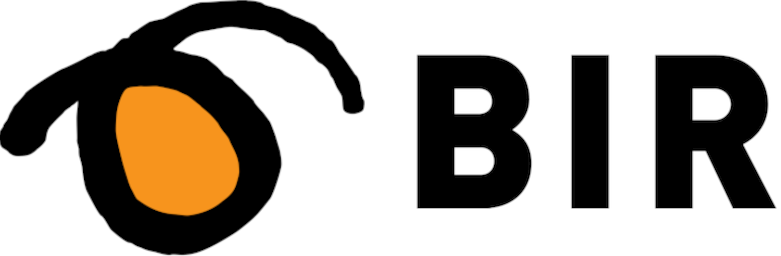

# BIR Waste Watch for Home Assistant

This is not an official integration from BIR!

This Home Assistant extension dynamically generates sensors for waste collection schedules based on your address. It fetches the data from BIRs API to find the appropriate dates for waste pickup and creates sensors accordingly.

## 🌟 Features

- 📍 Dynamically creates sensors based on the available waste types (e.g., Mixed Waste, Paper & Plastic, Food Waste or Glass & Metal) for your address.
- 🎛 Easy setup through Home Assistant's UI.

## 📝 Prerequisites

- Home Assistant instance up and running.
- Your garbage is picked up by BIR and your address is listed in BIR.no's database.

## 📦 Installation

Install BIR Waste Watch through HACS:

1. [Open this repository in HACS](https://my.home-assistant.io/redirect/hacs_repository/?owner=sanderblom&repository=690180198&category=integration), or search for **BIR Waste Watch** under **HACS → Integrations**.
2. Install the integration and restart Home Assistant.
3. Go to **Settings → Devices & services → Add integration**, search for **BIR Waste Watch**, and follow the [configuration guide](#configuration).

## Configuration 

Setting up BIR Waste Watch is easy with the built-in address search:

1. Go to **Settings** → **Devices & Services** → **Add Integration**
2. Search for **BIR Waste Watch** and click to add
3. Enter your address in the search field. (e.g., "Lillehatten 330")
4. Select your address from the list of matching results
5. Done! Sensors will be created for each waste type at your address

## Changing Your Address

If you move or need to change your address:

1. Go to **Settings** → **Devices & Services**
2. Find **BIR Waste Watch** and click on it
3. Click the **Configure** button (gear icon ⚙️)
4. Enter your new address and search
5. Select the correct address from the results
6. The integration will automatically update with your new address
